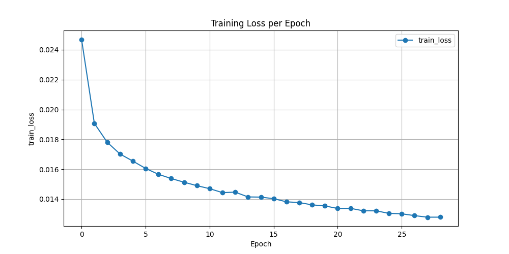
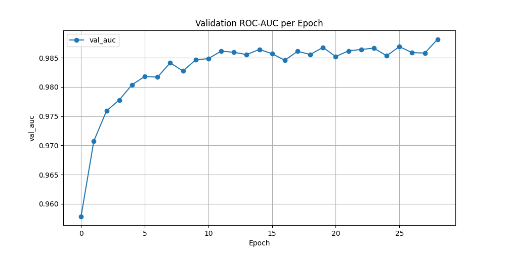
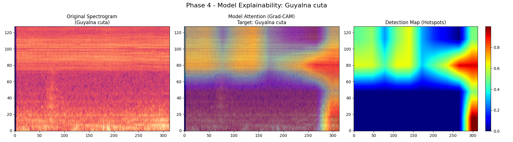
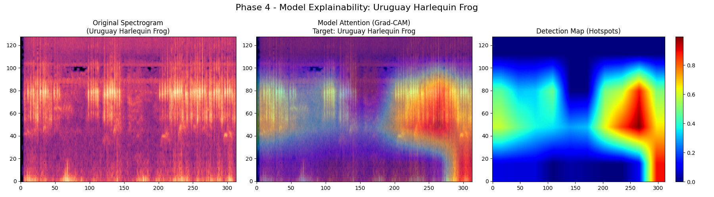
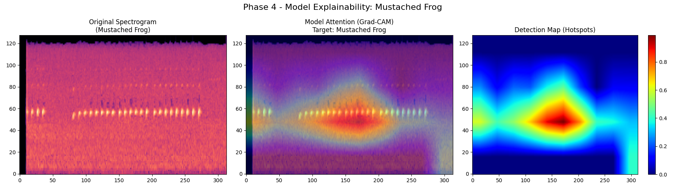

# BirdCLEF 2026 — Pantanal Acoustic Species Identification


End-to-end Sound Event Detection (SED) pipeline for identifying 234 Pantanal wildlife species from continuous passive acoustic monitoring recordings. Built for the [BirdCLEF+ 2026](https://www.kaggle.com/competitions/birdclef-2026) Kaggle competition.

---

## Results

| Metric | Value |
|---|---|
| Validation ROC-AUC (padded macro) | **0.9874** |
| Model parameters | 4.96 M |
| Inference time (60 s soundscape, CPU) | ~4 s |
| Training hardware | NVIDIA GTX 1650 Super (4 GB VRAM) |

The model converges cleanly, reaching 0.97 AUC by epoch 2 and stabilizing above 0.985 through the remaining epochs with no signs of overfitting.

<table>
  <tr>
    <td></td>
    <td></td>
  </tr>
  <tr>
    <td align="center">Training Loss — 30 epochs</td>
    <td align="center">Validation ROC-AUC — 30 epochs</td>
  </tr>
</table>

---

## Model Explainability — Grad-CAM

One of the core differentiators of this solution is its interpretability. Using **Grad-CAM (Gradient-weighted Class Activation Mapping)**, we extract the gradient signal flowing into the last convolutional block of EfficientNet-B0 and project it back onto the input Mel-Spectrogram. This produces a spatial heatmap that answers the question: *what part of the recording did the model actually react to?*

Each figure below shows three panels for a validation sample:
- **Left** — original log-Mel spectrogram
- **Center** — Grad-CAM overlay (warm regions = high activation)
- **Right** — isolated detection map

The results demonstrate that the model consistently localizes on true vocalization events — harmonic structures, repetitive pulse trains, and frequency-modulated calls — rather than background noise or recording artifacts.

<table>
  <tr>
    <td></td>
  </tr>
  <tr>
    <td align="center"><i>Guyalma cuta — model attends to the sustained harmonic call structure</i></td>
  </tr>
  <tr>
    <td></td>
  </tr>
  <tr>
    <td align="center"><i>Uruguay Harlequin Frog — detection map tightly aligned with the distinctive vertical call stripes</i></td>
  </tr>
  <tr>
    <td></td>
  </tr>
  <tr>
    <td align="center"><i>Mustached Frog — periodic pulse train correctly identified; background frames suppressed</i></td>
  </tr>
</table>

This level of transparency is critical for conservation applications, where ecologists need to audit automated detections before acting on them.

---

## Technical Approach

### Architecture

```
Raw Waveform  (1 × 160,000 samples @ 32 kHz)
      |
  MelSpectrogram + AmplitudeToDB              torchaudio — on-the-fly, runs on GPU
      |
  SpecAugment (FrequencyMask + TimeMask)      training only
      |
  Per-batch normalization                     zero mean, unit variance
      |
  EfficientNet-B0  (in_chans=1)               timm — ImageNet pretrained, 4.9 M params
      |
  Mean pool over frequency axis
      |
  AttentionPooling (2-layer MLP + Softmax)    learns which frames matter most
      |
  Linear (1280 → 234)
      |
  Logits  →  sigmoid()  →  species probabilities
```

### Training Strategy

| Component | Detail |
|---|---|
| Loss | BCEWithLogitsLoss (multi-label) |
| Optimizer | Adam, lr = 1e-3 |
| Mixed Precision | torch.cuda.amp (FP16) — fits 4 GB VRAM |
| MixUp | alpha = 0.5, applied per batch |
| SpecAugment | FrequencyMask(24), TimeMask(64) |
| Validation | 80/20 split, padded macro ROC-AUC |
| Tracking | MLflow — loss, AUC, Grad-CAM artifacts per epoch |
| Checkpoint | Saved on every AUC improvement |

### Why EfficientNet-B0 + Attention Pooling

Standard global average pooling discards temporal information — a bird that sings for 0.3 seconds in a 5-second window will be diluted. The learned **Attention Pooling** layer assigns higher weights to frames containing actual vocalizations, producing a clip-level embedding that is dominated by the signal rather than the silence.

---

## Project Structure

```
BirdCLEF+2026/
├── src/
│   ├── config.py              hyperparameters and data paths
│   ├── model.py               SEDModel — EfficientNet-B0 + AttentionPooling
│   ├── dataset.py             PyTorch Dataset — chunking, resampling, multi-hot labels
│   ├── train.py               training loop with AMP, MixUp, MLflow logging
│   ├── inference.py           CPU-only submission generator
│   ├── gradcam.py             Grad-CAM implementation
│   ├── phase4_inference.py    batch Grad-CAM visualization for validation set
│   ├── metrics.py             padded macro ROC-AUC (mirrors Kaggle scoring)
│   ├── eda.py                 metadata validation and taxonomy loading
│   └── generate_plots.py      training curve plots from MLflow data
├── kaggle_submission.ipynb    self-contained Kaggle notebook (auto-discovers all paths)
├── create_dummy_test.py       generates synthetic soundscapes for local testing
├── best_model.pth             trained weights (excluded from git — upload to Kaggle Models)
└── birdclef-2026-implementation-plan.md
```

---

## Reproducing

**Train**
```bash
python src/train.py
```
Monitor with `mlflow ui` — loss curves, AUC, and Grad-CAM artifacts are logged per epoch.

**Generate Grad-CAM visualizations**
```bash
python src/phase4_inference.py
```

**Local inference test**
```bash
python create_dummy_test.py   # generate synthetic 60-second soundscapes
python src/inference.py
```

**Kaggle submission**

Upload `best_model.pth` to *Kaggle Models* (Framework: PyTorch, License: Apache 2.0), add it to `kaggle_submission.ipynb` alongside the competition data, set Internet OFF, and submit.

---

## Hardware

Trained entirely on consumer hardware without cloud compute:

| Component | Spec |
|---|---|
| CPU | Intel Core i7-10700F |
| RAM | 32 GB DDR4 |
| GPU | NVIDIA GTX 1650 Super (4 GB VRAM) |

Mixed Precision (FP16) keeps peak VRAM usage under 3.2 GB throughout training.
